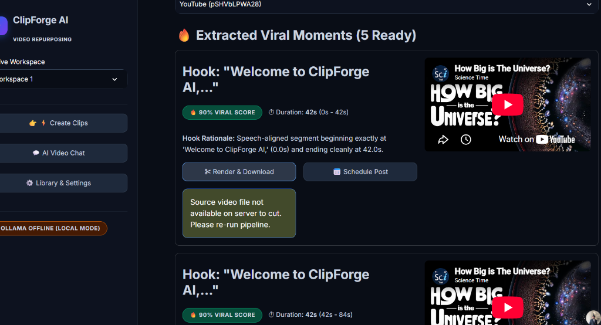
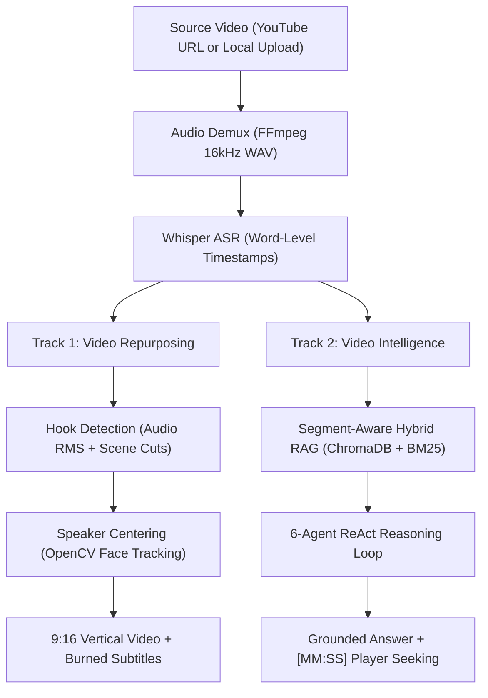

# ClipForge AI

ClipForge AI is an AI-powered video intelligence and repurposing platform that transforms long-form videos into short-form content and searchable knowledge.

The platform provides two primary capabilities:

- **Video Repurposing**: Ingests long-form video content, analyzes audio energy and visual scene transitions to identify engaging moments, tracks active speakers using facial detection, and exports 9:16 vertical shorts with burned animated subtitles.
- **Video Transcript Intelligence**: Chunks and indexes complete video transcripts into a hybrid retrieval store (dense vector embeddings combined with BM25 lexical ranking) and executes a multi-agent reasoning loop to answer questions grounded in the video timeline with exact, clickable `[MM:SS]` timestamp citations.

[](LICENSE)
[](skills/video-transcript-temporal-rag/LICENSE)
[](https://www.python.org/)

---

## Core Features

Features are categorized based on their current implementation and verification status in the codebase:

### Implemented and Tested

- **Video Ingestion**: Downloads YouTube videos via `yt-dlp` or accepts local file uploads (`.mp4`, `.mov`, `.mkv`), extracting container parameters and metadata.
- **Audio Extraction**: Extracts normalized 16kHz mono WAV audio tracks from ingested videos using FFmpeg for acoustic transcription.
- **Speech Transcription**: Generates word-level timestamped transcripts using OpenAI Whisper models (`base`, `small`, `medium`) with fallback handling.
- **Viral Moment Detection**: Analyzes rolling audio energy (RMS) and visual scene transitions, combining acoustic cues with language models to score clip virality and identify hooks.
- **Face-Aware Vertical Reframing**: Detects and tracks primary speaker coordinates across video frames using OpenCV Haar Cascades to crop 16:9 widescreen video into 9:16 vertical shorts.
- **Animated Subtitle Generation**: Compiles word-level timestamps into Advanced SubStation Alpha (`.ass`) subtitle files and burns synchronized subtitles into exported video clips using FFmpeg.
- **Transcript Indexing & Hybrid Retrieval**: Chunks transcripts into overlap-aware segments (120–180 words, 15–20% overlap), generating dense embeddings via ChromaDB and indexing lexical terms in SQLite BM25, fused using Reciprocal Rank Fusion (RRF).
- **Video Question Answering**: Coordinates a bounded 6-agent ReAct reasoning loop (Query Planner, Retrieval, Timeline, Verification, Synthesis, Safety Guardrail) that synthesizes answers citing millisecond-exact `[MM:SS]` timestamps.
- **Interactive Streamlit Studio**: Web interface supporting video upload, timeline video player with interactive timestamp jumping, short-form clip generation, and the integrated AI Engineering Lab.
- **FastAPI REST API**: High-performance backend gateway providing endpoints for chat QA, YouTube channel exploration, video processing, and laboratory benchmarks.

### Partially Implemented

- **React Frontend**: Modern web client built with React 19, Vite, and Tailwind CSS (`frontend/`). Core components and styling are implemented, while primary interactive playback and pipeline execution are currently hosted in the Streamlit application.

### Planned

- **Multimodal Visual RAG**: Indexing on-screen text (OCR), slide presentations, and visual scene embeddings alongside spoken transcripts.
- **Decoupled Standalone Agent Skills**: Packaging individual pipeline components (face reframing, viral detection, subtitle generation) into autonomous agent marketplace skills.
- **Social Media Publishing**: Direct export and scheduling to YouTube Shorts, Instagram Reels, and TikTok via official platform APIs.

---

## Product Showcase

### Automated Short Generation
The repurposing pipeline extracts high-energy moments, assigns virality scores, tracks the active speaker, and renders vertical 9:16 cuts ready for short-form platforms.

<p align="center">
  
</p>

---

## How ClipForge Works

ClipForge processes video media through two parallel processing tracks:



1. **Ingestion & Transcription**: The input video is ingested, converted to a standardized 16kHz mono WAV audio file, and transcribed using Whisper to produce word-level timestamps.
2. **Track 1 (Repurposing)**: Audio energy spikes and visual scene boundaries identify high-retention segments. OpenCV face tracking dynamically calculates horizontal offsets to keep speakers centered during 9:16 cropping, followed by burning styled `.ass` subtitles.
3. **Track 2 (Intelligence)**: Transcripts are partitioned into overlapping chunks, vectorized into ChromaDB, and indexed into SQLite BM25. A 6-agent ReAct loop processes incoming questions, retrieves balanced timeline context, verifies claims against source text, and returns structured answers with clickable timestamps.

---

## Technology Stack

The project relies on the following verified technologies:

| Category | Technologies | Description |
| :--- | :--- | :--- |
| **Backend & API** | Python 3.10–3.12, FastAPI, Uvicorn, SQLite | High-performance asynchronous REST API and local relational storage. |
| **Frontend & UI** | Streamlit, React 19, TypeScript, Vite, Tailwind CSS | Dual interface: primary Streamlit analytical studio and modern React web UI. |
| **AI & Machine Learning** | OpenAI Whisper, ChromaDB, Groq API, Gemini API, Ollama | Local speech recognition, dense vector indexing, cloud LLMs, and local offline inference. |
| **Video & Media Processing** | FFmpeg, FFprobe, OpenCV, yt-dlp | Container demuxing, video transcoding, Haar Cascade face detection, and YouTube ingestion. |
| **Storage & Retrieval** | SQLite (BM25 FTS5), ChromaDB | Project-partitioned vector embeddings and relational metadata persistence. |
| **Testing & Verification** | Python `unittest`, Pydantic | Rigorous offline test batteries and strict schema enforcement. |

---

## Developer SDK

For developers who require video transcript question answering without running the complete media processing stack (OpenCV, FFmpeg, PyTorch), ClipForge includes a standalone **Video Intelligence Developer SDK** in [`skills/video-transcript-temporal-rag/`](skills/video-transcript-temporal-rag/).

### SDK Overview

- **Universal Transcript Ingestion**: Built-in normalizer supports OpenAI Whisper JSON, YouTube Transcript API outputs, SRT, WebVTT, and plain timestamped text.
- **Timestamped Evidence Retrieval**: Extracts precise chronological segments with `[MM:SS]` start and end timecodes.
- **Hybrid Search**: Combines BM25 lexical ranking and Reciprocal Rank Fusion (RRF) for balanced semantic and keyword search.
- **6-Agent Cognitive ReAct Loop**: Coordinates Query Planning, Retrieval, Timeline Sorting, Claim Verification ($0.0–1.0$), Synthesis, and Safety Guardrails.
- **Zero Heavy Media Dependencies**: Requires only `pydantic` and `requests`. Runs entirely on CPU without GPU, PyTorch, or FFmpeg requirements.
- **Multi-Provider LLM Routing**: Supports Groq Cloud, Google Gemini, OpenAI, local Ollama, and an offline deterministic `MockProvider`.

### Python API Example

```python
from src.skill import VideoIntelligenceSkill

# 1. Initialize skill with preferred provider
skill = VideoIntelligenceSkill(provider="groq")

# 2. Ingest transcript (supports Whisper JSON, YouTube JSON, SRT)
transcript = skill.load_transcript("examples/sample_whisper.json")

# 3. Ask questions grounded in the video timeline
result = skill.ask("What is this video about?")
print(result.answer)

# 4. Access verified timestamp citations
for citation in result.citations:
    print(f"[{citation.timestamp}] {citation.text_excerpt}")
```

### CLI Runner Example

```bash
cd skills/video-transcript-temporal-rag

# Run offline with MockProvider
python runner.py --transcript examples/sample_whisper.json --query "What is this video about?" --provider mock --allow-mock

# Run with Groq Cloud provider
python runner.py --transcript examples/sample_whisper.json --query "What were the main developments?" --provider groq
```

For complete documentation, refer to the [Developer SDK README](skills/video-transcript-temporal-rag/README.md) and [Apache 2.0 License](skills/video-transcript-temporal-rag/LICENSE).

---

## ClipForge AI Skill Ecosystem

ClipForge AI is structured into modular capabilities suited for both developer integration and autonomous agent marketplaces:

| Skill / Capability | Development Status | Distribution & Scope | Description |
| :--- | :--- | :--- | :--- |
| **Video Transcript Intelligence** | Completed and tested | Public Developer SDK & Standalone Commercial Package | Deterministic temporal Q&A engine with millisecond-exact `[MM:SS]` citations and timeline summarization. |
| **Viral Moment Detector** | Planned | Standalone Agent Skill | Audio energy RMS peak detection, speech sentiment shifts, and visual cut boundaries to score clip virality. |
| **Face-Centric Video Reframer** | Planned | Standalone Agent Skill | Dynamic OpenCV / MediaPipe face tracking and smart bounding-box interpolation from 16:9 to 9:16 vertical shorts. |
| **Animated Subtitle Generator** | Planned | Standalone Agent Skill | Word-synchronized Advanced SubStation Alpha (`.ass`) animated subtitles with custom kinetic typography presets. |
| **YouTube Channel Content Intelligence** | Planned | Standalone Agent Skill | Flat channel metadata ingestion, cross-video topical indexing, and multi-video semantic comparison. |

> [!NOTE]
> The public Developer SDK is an open-source library (Apache 2.0). Standalone commercial packages tailored for autonomous agent platforms (such as Agensi.io) feature dedicated zero-dependency runtimes, cognitive workflow stages, and marketplace-specific packaging maintained separately.

---

## Installation and Quick Start

### Prerequisites

- **Python**: 3.10 to 3.12 installed.
- **FFmpeg & FFprobe**: Installed and added to system `PATH`.
  - Windows: `winget install Gyan.FFmpeg`
  - macOS: `brew install ffmpeg`
  - Linux: `sudo apt-get install ffmpeg`

### 1. Clone and Install Dependencies

```bash
git clone https://github.com/ravindrareddy17/ClipForge.git
cd ClipForge

# Create and activate virtual environment
python -m venv .venv

# Windows:
.\.venv\Scripts\activate
# Linux / macOS:
source .venv/bin/activate

# Install platform dependencies
pip install -r requirements.txt
```

### 2. Configure Environment Variables (Optional)

Configure API keys in your environment or in a local `.env` file:

```bash
# Windows PowerShell:
$env:GROQ_API_KEY="your-groq-key"
$env:GEMINI_API_KEY="your-gemini-key"

# Linux / macOS:
export GROQ_API_KEY="your-groq-key"
export GEMINI_API_KEY="your-gemini-key"
```

*(If no cloud keys are provided, ClipForge automatically falls back to local Ollama inference if installed).*

### 3. Launch Applications

**Run the Streamlit Studio (Default port 8501):**
```bash
streamlit run app.py
```

**Run the FastAPI Backend (Default port 8000):**
```bash
# Windows PowerShell:
$env:PYTHONPATH='backend'; python -m uvicorn clipforge_engine.main:app --port 8000 --reload

# Linux / macOS:
PYTHONPATH=backend python -m uvicorn clipforge_engine.main:app --port 8000 --reload
```

**Run the Developer SDK Offline Test Suite (46 Tests):**
```bash
python -m unittest discover -s skills/video-transcript-temporal-rag/tests -v
```

---

## Project Structure

```text
ClipForge/
├── app.py                             # Streamlit Studio (Interactive UI, Video Player, AI Lab)
├── requirements.txt                   # Platform Python dependencies
├── packages.txt                       # System binary dependencies (FFmpeg)
├── LICENSE                            # Root MIT License
├── .gitignore                         # Secret, database, and cache exclusion rules
├── backend/
│   └── clipforge_engine/
│       ├── main.py                    # FastAPI REST API application & routing
│       ├── pipeline.py                # Video ingestion, scene detection & clipping pipeline
│       ├── video_qa_agents.py         # 6-Agent bounded ReAct loop for video QA
│       ├── rag.py                     # Hybrid RAG engine (ChromaDB + SQLite BM25 + RRF)
│       ├── llm_client.py              # Multi-provider client (Groq, Gemini, Ollama)
│       ├── db.py                      # SQLite database schema, chunks, and session memory
│       ├── channel.py                 # YouTube channel batch ingestion & search
│       ├── cse473_lab.py              # AI Engineering Lab interactive simulation modules
│       └── services/                  # Core processing services
│           ├── video.py               # Scene detection, Haar Cascade face tracking, clipping
│           ├── transcribe.py          # Audio extraction and Whisper transcription
│           ├── subtitles.py          # Advanced SubStation Alpha (.ass) subtitle generator
│           └── ai.py                  # Audio RMS peak & hook virality detection
├── frontend/                          # React 19 + TypeScript + Vite web client
├── skills/
│   └── video-transcript-temporal-rag/ # Public Developer SDK (Apache 2.0 Video Intelligence Engine)
├── tests/                             # Automated test batteries
└── docs/                              # Technical specifications and documentation assets
```

---

## Licensing

ClipForge AI maintains a dual-licensing structure:

- **Core ClipForge Application**: The platform engine (`app.py`, `backend/`, `frontend/`, `tests/`) is open-source under the [MIT License](LICENSE).
- **Public Developer SDK**: The standalone Video Intelligence engine in [`skills/video-transcript-temporal-rag/`](skills/video-transcript-temporal-rag/) is open-source under the [Apache License, Version 2.0](skills/video-transcript-temporal-rag/LICENSE).
- **Commercial Standalone Skills**: Specialized commercial distributions and autonomous agent marketplace packages are distributed under separate commercial licensing terms with applicable open-source notices preserved.

---

## Interested in standalone ClipForge AI skills?

Additional commercial AI skills and marketplace-ready agent packages are maintained separately.

Interested developers, creators, and businesses can contact the creator to discuss:

- Available standalone skills
- Commercial licensing options
- Private repository access
- Custom AI skill development
- Collaboration and integration opportunities

Among the five skills outlined in the ecosystem roadmap, **Video Transcript Intelligence** is completed, locally tested, and available.

To discuss commercial access or custom skill integrations, reach out via email at [pasamravindrareddy8@gmail.com](mailto:pasamravindrareddy8@gmail.com).

---

## Connect

- **Email**: [pasamravindrareddy8@gmail.com](mailto:pasamravindrareddy8@gmail.com)
- **GitHub**: [@ravindrareddy17](https://github.com/ravindrareddy17)
