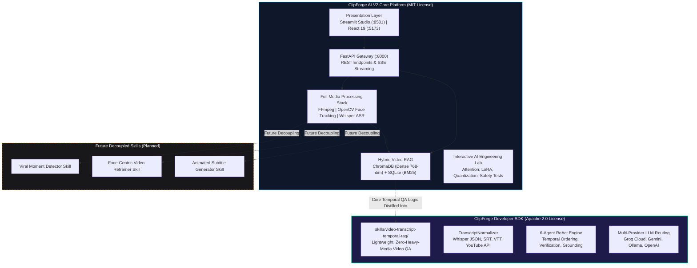

# ClipForge AI — Project Structure & Ecosystem Architecture

This document provides a comprehensive structural guide to the ClipForge AI open-source repository, detailing its module boundaries, component roles, data flow, and the relationship between the monolithic web platform and the standalone **Developer SDK**.

---

## 🏛️ High-Level Architectural Relationship

ClipForge is architected in a two-tier open-source structure designed for both complete desktop/web deployment and modular developer integration:



---

## 📂 Detailed Directory & Module Map

```text
ClipForge/
├── app.py                             # All-in-one Streamlit Studio UI
├── requirements.txt                   # Monolithic Python dependencies
├── packages.txt                       # OS binary dependencies (FFmpeg)
├── .gitignore                         # Comprehensive secret & cache exclusion rules
│
├── backend/
│   └── clipforge_engine/              # Core application engine & REST gateway
│       ├── main.py                    # FastAPI app, routing, CORS, and health checks
│       ├── video_qa_agents.py         # 6-Agent ReAct loop for video transcript Q&A
│       ├── rag.py                     # Hybrid RAG: ChromaDB + SQLite BM25 + RRF
│       ├── llm_client.py              # Multi-provider client (Groq, Gemini, Ollama, Bedrock)
│       ├── channel.py                 # YouTube channel batch ingestion & search
│       ├── db.py                      # SQLite database schema, chunks, and chat history
│       ├── cse473_lab.py              # AI Engineering Lab interactive simulation modules
│       ├── video_processor.py         # Video download, audio extraction, 9:16 vertical crop
│       └── whisper_transcriber.py     # Local OpenAI Whisper transcription pipeline
│
├── frontend/                          # Modern React 19 + Vite web interface
│   ├── src/
│   │   ├── components/                # Glassmorphic UI widgets, chat interface, player
│   │   ├── App.tsx                    # Root application component
│   │   └── main.tsx                   # Vite mount point
│   ├── package.json                   # Node.js dependencies
│   └── vite.config.ts                 # Vite bundler configuration
│
├── skills/
│   └── video-transcript-temporal-rag/ # Public Developer SDK (Apache License 2.0)
│       ├── package.json               # Package metadata and CLI commands
│       ├── pyproject.toml             # Python package configuration
│       ├── requirements.txt           # Minimal runtime dependencies (pydantic, requests)
│       ├── runner.py                  # CLI runner (CLI flags & STDIN streaming)
│       ├── SKILL.md                   # Agent system prompt & tool calling contracts
│       ├── src/                       # Core SDK Python package
│       │   ├── skill.py               # Main high-level entrypoint (VideoIntelligenceSkill)
│       │   ├── engine.py              # 6-Agent ReAct loop coordinator
│       │   ├── ranker.py              # Pure-Python BM25 scoring algorithm
│       │   ├── normalizer.py          # Auto-detection for Whisper, SRT, VTT, YouTube JSON
│       │   ├── models.py              # Core data models (Transcript, Segment, QueryResult)
│       │   ├── agents/                # 6 specialized agent implementations
│       │   │   ├── planner.py         # Query normalization & intent classification
│       │   │   ├── retrieval.py       # Context extraction & lexical candidate retrieval
│       │   │   ├── timeline.py        # Chronological sorting & sequence validation
│       │   │   ├── verification.py    # Claim validation & evidence confidence scoring
│       │   │   ├── synthesis.py       # Answer formatting & bracketed timestamp citation
│       │   │   └── safety.py          # Prompt injection defense & honest refusal
│       │   └── providers/             # LLM provider routing adapters
│       │       ├── base.py            # Abstract BaseProvider interface
│       │       ├── groq_provider.py   # Groq Cloud integration (openai/gpt-oss-20b)
│       │       ├── gemini_provider.py # Google Gemini API integration (gemini-2.5-flash)
│       │       ├── openai_provider.py # OpenAI API integration (gpt-4o-mini)
│       │       ├── ollama_provider.py # Local Ollama offline daemon
│       │       └── mock_provider.py   # Deterministic offline test provider
│       ├── schemas/                   # JSON Schema definitions for inputs and outputs
│       ├── examples/                  # Sample transcripts for testing and quickstart
│       └── tests/                     # 46-point automated test suite for SDK
│
├── tests/                             # Full-system test battery
│   ├── test_clipforge_v2.py           # 20-Point regression, security, and RAG test battery
│   └── test_video_summary_intent.py   # Intent routing and whole-video sampling tests
│
└── docs/                              # Technical specifications and architectural guides
    ├── PROJECT_STRUCTURE.md           # This document
    ├── ARCHITECTURE.md                # System layers, component diagrams, and data flows
    ├── RAG.md                         # Hybrid retrieval & RRF mathematical formulation
    ├── AGENTS.md                      # ReAct agent specifications & tool definitions
    ├── EVALUATION.md                  # 20-point evaluation rubric and benchmark results
    ├── SECURITY.md                    # Adversarial audio defense & API key protection
    └── CSE473_RPL_MAPPING.md          # Topic-by-topic implementation syllabus mapping
```

---

## 🔄 Core Web Platform vs. Public Developer SDK

A key design achievement of ClipForge is separating **heavy multimedia pipelines** from **lightweight cognitive reasoning**:

| Feature / Metric | ClipForge AI V2 Core Platform | Public Developer SDK (`skills/video-transcript-temporal-rag`) |
| :--- | :--- | :--- |
| **Primary Scope** | Full-stack video processing, vertical short generation, and visual playback | Lightweight, embeddable video transcript reasoning & temporal QA |
| **License** | **MIT License** | **Apache License 2.0** |
| **Dependencies** | Heavy (`torch`, `opencv-python`, `ffmpeg`, `chromadb`, `streamlit`) | Ultra-lightweight (`pydantic`, `requests` only) |
| **Hardware Need** | CPU/GPU for video demuxing, frame analysis, and local Whisper | Any minimal Python 3.10+ environment (Cloud, Serverless, Agent containers) |
| **Vector Storage** | Persistent local ChromaDB collections partitioned by project ID | In-memory tokenization & pure-Python BM25 ranking (benchmarked at <15ms on 8m reference transcript) |
| **User Interface** | Interactive Streamlit Studio (:8501) and React 19 Frontend (:5173) | Direct Python API (`VideoIntelligenceSkill`) and CLI runner (`runner.py`) |
| **Audio Processing** | FFmpeg demuxing + local Whisper speech transcription | Consumes pre-computed transcripts in any standard format |
| **Timestamp Citations** | Clickable `[MM:SS]` buttons that jump embedded HTML5 video player | Structured `[MM:SS]` citation objects with excerpt verification |

---

## 🌐 The ClipForge AI Skill Ecosystem

ClipForge is transitioning toward a modular skill-based architecture. Under this vision, capabilities originally bundled into the monolithic engine are extracted into standalone, reusable modules:

```text
                  ┌───────────────────────────────────────────────┐
                  │              ClipForge Monolith               │
                  │   (app.py + backend/clipforge_engine/...)    │
                  └───────────────────────┬───────────────────────┘
                                          │
                  ┌───────────────────────┼───────────────────────┐
                  ▼                       ▼                       ▼
      ┌───────────────────────┐ ┌───────────────────┐ ┌───────────────────────┐
      │  Video Intelligence   │ │   Viral Moment    │ │  Face-Centric Video   │
      │     Developer SDK     │ │     Detector      │ │       Reframer        │
      │ (Completed, Apache-2) │ │    (Roadmap)      │ │      (Roadmap)        │
      └───────────────────────┘ └───────────────────┘ └───────────────────────┘
                  │                       │                       │
                  └───────────────────────┼───────────────────────┘
                                          ▼
                  ┌───────────────────────────────────────────────┐
                  │       Autonomous AI Agents & Pipelines        │
                  │  (Claude Code, Antigravity, Cursor, Copilot)  │
                  └───────────────────────────────────────────────┘
```

1. **Video Transcript Intelligence (Completed & Released):**
   - Packaged as the public Developer SDK in this repository.
   - Extracts semantic insights, answers factual questions, and provides chronologically sound video summaries.
2. **Viral Moment Detector (Planned):**
   - Will extract the audio energy peak algorithm and visual scene-cut scoring from `backend/clipforge_engine/video_processor.py` into a standalone CLI/skill.
3. **Face-Centric Video Reframer (Planned):**
   - Will package the OpenCV face-tracking and 9:16 vertical crop logic into an independent video transformation tool.
4. **Animated Subtitle Generator (Planned):**
   - Will decouple the Advanced SubStation Alpha (`.ass`) caption compiler into a kinetic typography generator.

---

## 🛡️ Licensing Architecture & Boundaries

ClipForge follows a clear, multi-tier licensing policy:

1. **ClipForge Platform (MIT):**
   - All files in the root repository, `backend/`, `frontend/`, `tests/`, and `docs/` are governed by the MIT License, allowing unrestricted academic, personal, and commercial modification.
2. **ClipForge Developer SDK (Apache 2.0):**
   - The standalone package in `skills/video-transcript-temporal-rag/` is licensed under Apache 2.0, providing explicit patent protection and attribution requirements for library consumers.
3. **Commercial Marketplace Editions:**
   - Dedicated standalone commercial editions optimized for specific autonomous agent marketplaces (such as Agensi.io) are distributed independently with zero-dependency preprocessors and proprietary commercial licensing terms. These commercial editions maintain strict attribution for underlying open-source algorithms (such as BM25 ranking) in full compliance with the Apache 2.0 license.

---

## 🔗 Related Documentation

- [System Architecture](ARCHITECTURE.md) — Detailed layer descriptions and data flow
- [Hybrid RAG Specification](RAG.md) — Mathematical formulation of dense vectors + BM25 + RRF
- [Multi-Agent Reasoning](AGENTS.md) — ReAct loop specifications and agent personas
- [Evaluation Rubric](EVALUATION.md) — 20-point test battery results
- [Security Protocol](SECURITY.md) — Prompt injection mitigation and secret management
