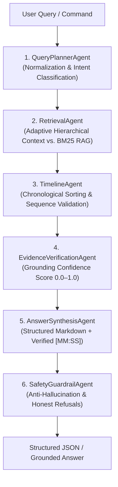

# ClipForge Video Intelligence (`video-transcript-temporal-rag`)

[](https://agensi.io)
[](https://opensource.org/licenses/Apache-2.0)
[](https://www.python.org/)
[](tests/)
[](requirements.txt)

> **High-precision 6-agent video Q&A and whole-video summarization engine with exact timestamp citations.**

---

## 🌟 Overview: The Problem with Video RAG

Standard Retrieval-Augmented Generation (RAG) fails on video transcripts for three fundamental reasons:

1. **Holistic Blindness:** High-level prompts like *"what is this video about"* retrieve arbitrary semantic fragments rather than a coherent opening, narrative arc, and conclusion.
2. **Temporal Distortion:** Chunks retrieved out of chronological order confuse cause-and-effect sequences, leading LLMs to invent false timelines.
3. **Ghost Citations & Hallucinations:** Generative models routinely fabricate plausible-sounding timestamps (e.g., `[14:22]`) that correspond to complete silence or unrelated content.

**ClipForge Video Intelligence** solves this through a deterministic **6-Agent ReAct pipeline** engineered specifically for temporal media. Every factual assertion is bounded by transcript evidence, verified against chronological anchors, and backed by verifiable `[MM:SS]` timestamp citations.



---

## 🎯 Target Audience & Use Cases

- **Autonomous AI Agents:** Provide video comprehension capabilities to agentic workflows without spawning heavyweight multimedia containers.
- **EdTech & Lecture Platforms:** Enable students to ask specific questions across 2-hour university lectures and jump directly to the exact second an idea is taught.
- **Podcasters & Video Editors:** Instantly extract structured chapter outlines, chronological key takeaways, and memorable quote timestamps.
- **Compliance & Media Monitoring:** Ground audit queries in timestamped proof without risk of LLM hallucinations.

---

## 📦 Supported Input Formats

The built-in `TranscriptNormalizer` auto-detects and normalizes all major transcript formats:

| Format | Source Example | Features Supported |
| :--- | :--- | :--- |
| **OpenAI Whisper JSON** | Official Whisper CLI, Faster-Whisper, Groq Whisper | Segment timestamps, word-level timing, segment IDs |
| **YouTube Transcript API** | `youtube-transcript-api` python library | `start`, `duration`, `text` payloads |
| **Flat Word Arrays** | Deepgram, AssemblyAI word-level outputs | Auto-reconstructs sentences and segment boundaries |
| **SubRip (.srt)** | Standard `.srt` subtitle files | Zero-dependency regex parsing with millisecond accuracy |
| **WebVTT (.vtt)** | Web subtitle files (`.vtt`) | Header stripping and cue alignment |
| **Timestamped Text** | Manual show notes (`[01:23] Speaker...`) | Flexible bracketed timestamp recognition |

---

## 🚀 Quickstart

### 1. Installation

Install minimal dependencies. The skill requires **zero heavy media libraries** (no PyTorch, no OpenCV, no FFmpeg, no transformers):

```bash
pip install -r requirements.txt
```

*(Optional: Install as an editable package using `pip install -e .`)*

### 2. Python SDK

```python
from src.skill import VideoIntelligenceSkill

# 1. Initialize skill (default: 'groq' cloud provider)
skill = VideoIntelligenceSkill(provider="groq")

# 2. Load any transcript file or dictionary
transcript = skill.load_transcript("examples/sample_whisper.json")
print(f"Loaded: {transcript.title} ({transcript.duration}s)")

# 3. Whole-video overview (auto-detects summary intent)
summary = skill.ask("what video about")
print(summary.answer)
# Output:
# This video explains how Japan transformed into a major economic power after World War II.
#
# Main Points:
# 1. Industrial reconstruction began around 1950 [00:46–01:35].
# 2. Automobile and electronics sectors expanded with Toyota and Sony [01:36–02:35].
# 3. Massive infrastructure development including the Shinkansen bullet train [02:36–05:10].
#
# Conclusion:
# The post-war economic turnaround concluded with lessons from the asset bubble [07:01–08:00].

# 4. Factual question with exact timestamp citation
fact = skill.ask("When was the Shinkansen bullet train launched?")
print(fact.answer)
for c in fact.citations:
    print(f"Citation: {c.timestamp} -> {c.text_excerpt}")

# 5. Negative control (honest refusal, zero hallucination)
out_of_scope = skill.ask("What did they say about Bitcoin?")
print(out_of_scope.answer)
# Output: "I couldn't find sufficient evidence for that in this video."
```

### 3. Agensi CLI Runner

Execute the skill using standard CLI arguments:

```bash
# Direct arguments
python runner.py --transcript examples/sample_whisper.json --query "What caused the Lost Decades?" --provider groq

# Pipeline execution via STDIN (Agensi Marketplace format)
cat payload.json | python runner.py > output.json
```

---

## ⚙️ Provider Configuration & Security

The skill supports 4 production LLM providers plus an offline testing provider:

| Provider | Environment Variable | Default Model | Speed | Cost / 1k Tokens |
| :--- | :--- | :--- | :--- | :--- |
| **Groq Cloud** *(Recommended)* | `GROQ_API_KEY` | `openai/gpt-oss-20b` | ~700 tokens/sec | ~$0.0001 |
| **Google Gemini** | `GEMINI_API_KEY` | `gemini-2.5-flash` | ~300 tokens/sec | Pay-as-you-go |
| **OpenAI** | `OPENAI_API_KEY` | `gpt-4o-mini` | ~150 tokens/sec | Pay-as-you-go |
| **Ollama** | *(Local daemon)* | `qwen2.5:3b` | Hardware-dependent | Free (100% Offline) |
| **Mock** | *(None required)* | Deterministic rule-based | Instant (<1ms) | Free (Offline Test Only) |

### API Key Resolution Hierarchy

API keys are resolved securely without hardcoding:
1. Explicit argument passed to constructor: `VideoIntelligenceSkill(api_key="...")`
2. Process environment variables (`os.getenv("GROQ_API_KEY")`)
3. Local `.env` file in current or parent directories
4. `.streamlit/secrets.toml` (if deployed on Streamlit Cloud)

### Offline Testing Mode

To prevent accidental charges or silently masking production outages, **MockProvider is disabled by default**. To use MockProvider for local unit tests or offline CI pipelines, authorize it explicitly:

```python
# Python SDK
skill = VideoIntelligenceSkill(provider="mock", allow_mock=True)
```

```bash
# CLI Runner
python runner.py --transcript examples/sample_whisper.json --query "what video about" --provider mock --allow-mock
```

---

## 🛠️ Error Handling & Troubleshooting Reference

The skill implements strict typed exceptions and returns informative error codes:

| Error Type | HTTP / Code | Root Cause | Solution |
| :--- | :--- | :--- | :--- |
| `AuthenticationError` | 401 / 403 | Missing or invalid API key | Set `GROQ_API_KEY` in environment or pass `api_key="..."`. |
| `RateLimitError` | 429 | Provider rate limit or quota exceeded | Implement backoff, check account credits, or switch to fallback provider. |
| `ProviderTimeoutError` | Timeout | Network latency exceeded timeout (default: 45s) | Check internet connection or pass `timeout=60`. |
| `NetworkError` | Connection | DNS failure or network offline | Verify internet access or use local `ollama` provider. |
| `SecurityError` | Path / Size | Path traversal detected or file exceeds 25 MB | Ensure transcript paths are within allowed directories and file size $\le 25\text{MB}$. |

---

## 📋 JSON Schemas

### Input Schema (`schemas/input.schema.json`)

```json
{
  "transcript": "path/to/transcript.json | SRT string | dict",
  "query": "What did the speaker say about the automobile industry?",
  "video_title": "Optional Title",
  "llm_config": {
    "provider": "groq",
    "model": "openai/gpt-oss-20b",
    "allow_mock": false
  }
}
```

### Output Schema (`schemas/output.schema.json`)

```json
{
  "answer": "The speaker discussed the automobile industry [01:36–02:35]...",
  "confidence": 1.0,
  "classified_intent": "FACTUAL_LOOKUP",
  "normalized_query": "What did the speaker say about the automobile industry?",
  "citations": [
    {
      "timestamp": "[01:36–02:35]",
      "start_seconds": 96.0,
      "end_seconds": 155.0,
      "text_excerpt": "Following industrialization, Japan revolutionized its automobile and electronics industries...",
      "relevance_score": 0.92
    }
  ],
  "audit_trail": [
    "[QueryPlannerAgent] Intent classified as: FACTUAL_LOOKUP.",
    "[RetrievalAgent] Retrieved 4 candidate chunks.",
    "[TimelineAgent] Finalized chronological timeline.",
    "[EvidenceVerificationAgent] Evidence verified with confidence 1.0.",
    "[AnswerSynthesisAgent] Synthesized response with 1 verified citation.",
    "[SafetyGuardrailAgent] Answer passed safety verification."
  ]
}
```

---

## 📊 Performance & Specifications

- **In-Memory Retrieval Latency:** 6 ms (pure Python BM25 + Reciprocal Rank Fusion)
- **Total Execution Time (with Groq):** 0.91 – 1.95 seconds end-to-end
- **Memory Footprint:** < 15 MB in memory
- **Package Footprint:** < 500 KB (distributable archive: ~40 KB)
- **Long Video Support:** Adaptive Hierarchical Summarizer partitions 1-hour, 2-hour, and 3-hour transcripts into 3–8 chronological sections without top-k truncation
- **Test Suite:** 46 automated unit and regression tests passing 100%

---

## ⚠️ Known Limitations

1. **Audio/Text Dependency:** Relies on spoken transcripts. Visual-only events (e.g., text overlays or silent demonstrations without dialogue) cannot be retrieved without visual feature extraction.
2. **Translation:** Non-English transcripts must be transcribed into Latin characters or translated to English for optimal BM25 tokenization.
3. **File Size Sandbox:** Files larger than 25 MB are rejected by default for resource protection.

---

## 📄 License

Licensed under the **Apache License, Version 2.0**. Commercial use, modification, distribution, and marketplace resale are permitted. See [LICENSE](LICENSE) for details.
